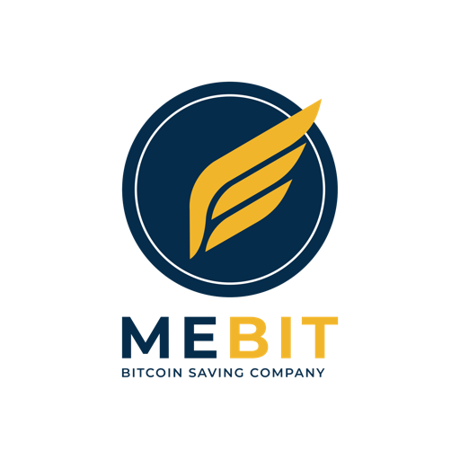

# Mebit Wallet

**English** | [ภาษาไทย](README.th.md)

[](LICENSE)


<p align="center">
  
</p>

<p align="center">Bitcoin self-custody for Thai users, on iOS and Android</p>

---

**Mebit Wallet** is a self-custody Bitcoin wallet. Your keys stay on your phone or on a hardware wallet, and no single party, Mebit included, can move your coins alone. Start with one key on the phone, then grow into a wallet that needs several keys to spend. Buy-sell and BTC-backed lending come later, built on the same wallet.

> **Testnet only.** The app runs on Bitcoin testnet4 today. Do not send real BTC to it.

## Features

- **Single-key wallet.** A BIP-84 (native SegWit) wallet kept on the phone, with send, receive, fee tiers and history.
- **Several-key wallet.** M-of-N multisig (`wsh(sortedmulti)`) where any mix of phone and hardware keys co-sign.
- **Hardware wallets over Bluetooth.** Blockstream Jade and Trezor Safe 7.
- **PSBT signing.** Every payment is one PSBT, checked before any key signs it.
- **Wallet files.** Import and export a several-key wallet as a BIP-129 (BSMS) record or a descriptor.
- **24-word backup.** Backup can be skipped at setup, but is required before the first receive.

## Architecture

```
┌──────────────────────────────┐        ┌──────────────────────────┐
│  Mobile app (iOS / Android)  │        │  Hardware wallet         │
│  Kotlin + Compose MP         │◀──BLE─▶│  Jade · Trezor Safe 7    │
│  ─────────────────────────── │        └──────────────────────────┘
│  mobile-signer-ffi (Rust)    │
│  via UniFFI                  │──HTTPS─▶ Esplora (testnet4)
│  ─────────────────────────── │
│  vault-core (Rust)           │
│  descriptors, PSBT, policy   │
└──────────────────────────────┘
```

The app talks to the Bitcoin network directly through Esplora. It does not route wallet traffic through a Mebit server.

## Repository layout

```
mebit/
├── vault-workspace/          # Rust workspace (run cargo from here)
│   ├── vault-core/           # descriptors, key derivation, PSBT, policy engine, hardware-wallet protocols
│   ├── mobile-signer-ffi/    # the app: Rust core + UniFFI bindings + Kotlin Multiplatform project in app/
│   ├── jade-ble/             # Jade Bluetooth transport
│   ├── trezor-ble/           # Trezor Safe 7 Bluetooth transport
│   ├── wallet-e2e/           # end-to-end signing checks against testnet
│   ├── custody-service/      # lending: platform signing service
│   ├── lender-signer-cli/    # lending: offline signer for the lender
│   └── monitor-service/      # lending: LTV monitoring and liquidation triggers
├── docs/                     # product, specs and decisions (index: docs/00-README.md)
├── design-reference/         # design tokens and fonts
├── assets/                   # images used by the README
└── scripts/                  # repo checks
```

Each crate has its own `README.md`.

## Build & Run

### Prerequisites

- [Rust](https://rustup.rs/) stable
- Xcode, for iOS builds and for the Rust libraries the app links
- Android Studio or the Android SDK, plus `cargo-ndk`, for Android builds
- Python 3

The Kotlin Toolchain bootstraps itself through `./kotlin` in the app folder. No separate install is needed.

### Rust core

```bash
cd vault-workspace
cargo test
```

`jade-ble` and `trezor-ble` sit outside the default members. Build them with `-p jade-ble` or `-p trezor-ble`. The Trezor protocol in `vault-core` needs `--features trezor`.

### Mobile app

```bash
cd vault-workspace/mobile-signer-ffi
scripts/ffi.sh build          # build the Rust libraries and Kotlin bindings (needs macOS)

cd app
./kotlin run -m androidApp    # Android
./kotlin run -m iosApp        # iOS
./kotlin test                 # tests
```

To use your own Esplora host, put it on one line in `vault-workspace/mobile-signer-ffi/esplora-host.local`. Git ignores that file, and the wallet tries that host before the public ones.

## Documentation

- [`docs/07-product-vision-mebit.md`](docs/07-product-vision-mebit.md) covers the product: wallet, buy-sell and lending.
- [`docs/08-multisig-wallet-spec.md`](docs/08-multisig-wallet-spec.md) is the wallet's technical spec.
- [`docs/09-wallet-mvp-buildplan.md`](docs/09-wallet-mvp-buildplan.md) is the current build plan.
- [`docs/04-open-items.md`](docs/04-open-items.md) lists decisions that are not final yet.
- [`docs/00-README.md`](docs/00-README.md) indexes everything else, including the lending specs.

## Contributing

`AGENTS.md` holds the shared instructions for coding agents, and `CLAUDE.md` imports it. Module briefs live in `.claude/agents/` and shared skills in `.claude/skills/`. After editing any of them, run `python3 -I scripts/check-agent-context.py`.

The policy engine in `vault-core` decides what a PSBT may pay before any key signs it. Changes to it need review from both `vault-core` owners and new adversarial tests.

## Responsible Disclosure

Please report security issues by email to [meet@mebit.co.th](mailto:meet@mebit.co.th), not in a public issue.

## License

Mebit Wallet is released under the [MIT License](LICENSE).
