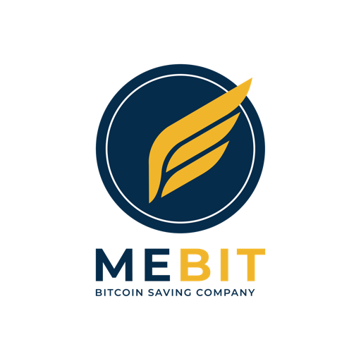

# Mebit Wallet

[English](README.md) | **ภาษาไทย**

[](LICENSE)


<p align="center">
  
</p>

<p align="center">กระเป๋า Bitcoin ที่คุณถือกุญแจเอง สำหรับคนไทย บน iOS และ Android</p>

---

**Mebit Wallet** คือกระเป๋า Bitcoin แบบ self-custody กุญแจอยู่ในมือถือของคุณหรือใน hardware wallet และไม่มีฝ่ายใดฝ่ายเดียว รวมถึง Mebit เอง ที่ย้ายเหรียญของคุณได้ เริ่มจากกุญแจเดียวในมือถือ แล้วค่อยขยายเป็นกระเป๋าที่ต้องใช้หลายกุญแจในการโอน บริการซื้อขายและสินเชื่อโดยใช้ BTC ค้ำประกันจะตามมาทีหลัง โดยสร้างบนกระเป๋าตัวเดียวกันนี้

> **ใช้ได้แค่ testnet** ตอนนี้แอปทำงานบน Bitcoin testnet4 เท่านั้น ห้ามส่ง BTC จริงเข้ามา

## ฟีเจอร์

- **กระเป๋ากุญแจเดียว** กระเป๋า BIP-84 (native SegWit) ในมือถือ ส่ง รับ เลือกค่าธรรมเนียม และดูประวัติได้
- **กระเป๋าหลายกุญแจ** multisig แบบ M-of-N (`wsh(sortedmulti)`) ที่ใช้กุญแจในมือถือและ hardware wallet ผสมกันเซ็นได้
- **Hardware wallet ผ่าน Bluetooth** รองรับ Blockstream Jade และ Trezor Safe 7
- **เซ็นด้วย PSBT** ทุกการโอนเป็น PSBT หนึ่งชุด และถูกตรวจก่อนกุญแจใดจะเซ็น
- **ไฟล์กระเป๋า** นำเข้าและส่งออกกระเป๋าหลายกุญแจเป็นไฟล์ BIP-129 (BSMS) หรือ descriptor
- **สำรอง 24 คำ** ข้ามขั้นตอนสำรองตอนสร้างกระเป๋าได้ แต่ต้องสำรองก่อนรับเงินครั้งแรก

## สถาปัตยกรรม

<video src="https://raw.githubusercontent.com/Krittanai2933/mebit/main/assets/readme/vault-signer-architecture.mp4" controls muted playsinline width="100%"></video>

[สถาปัตยกรรม vault signer (วิดีโอ)](assets/readme/vault-signer-architecture.mp4)

แอปคุยกับเครือข่าย Bitcoin โดยตรงผ่าน Esplora ข้อมูลกระเป๋าไม่ผ่านเซิร์ฟเวอร์ของ Mebit

## โครงสร้าง repo

```
mebit/
├── vault-workspace/          # Rust workspace (รัน cargo จากที่นี่)
│   ├── vault-core/           # descriptor, การ derive กุญแจ, PSBT, policy engine, โปรโตคอล hardware wallet
│   ├── mobile-signer-ffi/    # ตัวแอป: แกน Rust + UniFFI bindings + โปรเจกต์ Kotlin Multiplatform ใน app/
│   ├── jade-ble/             # ช่องทาง Bluetooth ของ Jade
│   ├── trezor-ble/           # ช่องทาง Bluetooth ของ Trezor Safe 7
│   ├── wallet-e2e/           # ทดสอบการเซ็นแบบ end-to-end บน testnet
│   ├── custody-service/      # สินเชื่อ: บริการเซ็นฝั่งแพลตฟอร์ม
│   ├── lender-signer-cli/    # สินเชื่อ: ตัวเซ็นแบบออฟไลน์ของผู้ให้กู้
│   └── monitor-service/      # สินเชื่อ: เฝ้าดู LTV และสั่งชำระบัญชี
├── docs/                     # ผลิตภัณฑ์ สเปก และการตัดสินใจ (สารบัญ: docs/00-README.md)
├── design-reference/         # design tokens และฟอนต์
├── assets/                   # รูปที่ใช้ใน README
└── scripts/                  # สคริปต์ตรวจ repo
```

แต่ละ crate มี `README.md` ของตัวเอง

## Build และรัน

### สิ่งที่ต้องมี

- [Rust](https://rustup.rs/) รุ่น stable
- Xcode สำหรับ build iOS และ build ไลบรารี Rust ที่แอปใช้
- Android Studio หรือ Android SDK และ `cargo-ndk` สำหรับ build Android
- Python 3

Kotlin Toolchain ติดตั้งตัวเองผ่าน `./kotlin` ในโฟลเดอร์แอป ไม่ต้องติดตั้งแยก

### แกน Rust

```bash
cd vault-workspace
cargo test
```

`jade-ble` และ `trezor-ble` ไม่อยู่ใน default members ให้ build ด้วย `-p jade-ble` หรือ `-p trezor-ble` ส่วนโปรโตคอล Trezor ใน `vault-core` ต้องใช้ `--features trezor`

### แอปมือถือ

```bash
cd vault-workspace/mobile-signer-ffi
scripts/ffi.sh build          # build ไลบรารี Rust และ Kotlin bindings (ต้องใช้ macOS)

cd app
./kotlin run -m androidApp    # Android
./kotlin run -m iosApp        # iOS
./kotlin test                 # รันเทสต์
```

ถ้าจะใช้ Esplora ของตัวเอง ให้ใส่ host หนึ่งบรรทัดในไฟล์ `vault-workspace/mobile-signer-ffi/esplora-host.local` git จะไม่ track ไฟล์นี้ และกระเป๋าจะลอง host นี้ก่อน host สาธารณะ

## เอกสาร

- [`docs/07-product-vision-mebit.md`](docs/07-product-vision-mebit.md) ภาพรวมผลิตภัณฑ์ ได้แก่ กระเป๋า ซื้อขาย และสินเชื่อ
- [`docs/08-multisig-wallet-spec.md`](docs/08-multisig-wallet-spec.md) สเปกทางเทคนิคของกระเป๋า
- [`docs/09-wallet-mvp-buildplan.md`](docs/09-wallet-mvp-buildplan.md) แผนการสร้างปัจจุบัน
- [`docs/04-open-items.md`](docs/04-open-items.md) เรื่องที่ยังไม่ได้ตัดสินใจ
- [`docs/00-README.md`](docs/00-README.md) สารบัญเอกสารทั้งหมด รวมสเปกสินเชื่อ

## การมีส่วนร่วม

`AGENTS.md` เก็บคำสั่งกลางสำหรับ coding agent และ `CLAUDE.md` import ไฟล์นั้น brief ของแต่ละโมดูลอยู่ใน `.claude/agents/` และ skill ที่ใช้ร่วมกันอยู่ใน `.claude/skills/` หลังแก้ไฟล์เหล่านี้ให้รัน `python3 -I scripts/check-agent-context.py`

policy engine ใน `vault-core` เป็นตัวตัดสินว่า PSBT จ่ายไปที่ไหนได้บ้างก่อนที่กุญแจใดจะเซ็น การแก้ส่วนนี้ต้องให้เจ้าของ `vault-core` ทั้งสองคนรีวิว และต้องมีเทสต์เชิงโจมตีใหม่ด้วย

## การแจ้งช่องโหว่

กรุณาแจ้งปัญหาด้านความปลอดภัยทางอีเมล [meet@mebit.co.th](mailto:meet@mebit.co.th) อย่าเปิดเป็น issue สาธารณะ

## สัญญาอนุญาต

Mebit Wallet ใช้สัญญาอนุญาต [MIT](LICENSE)
