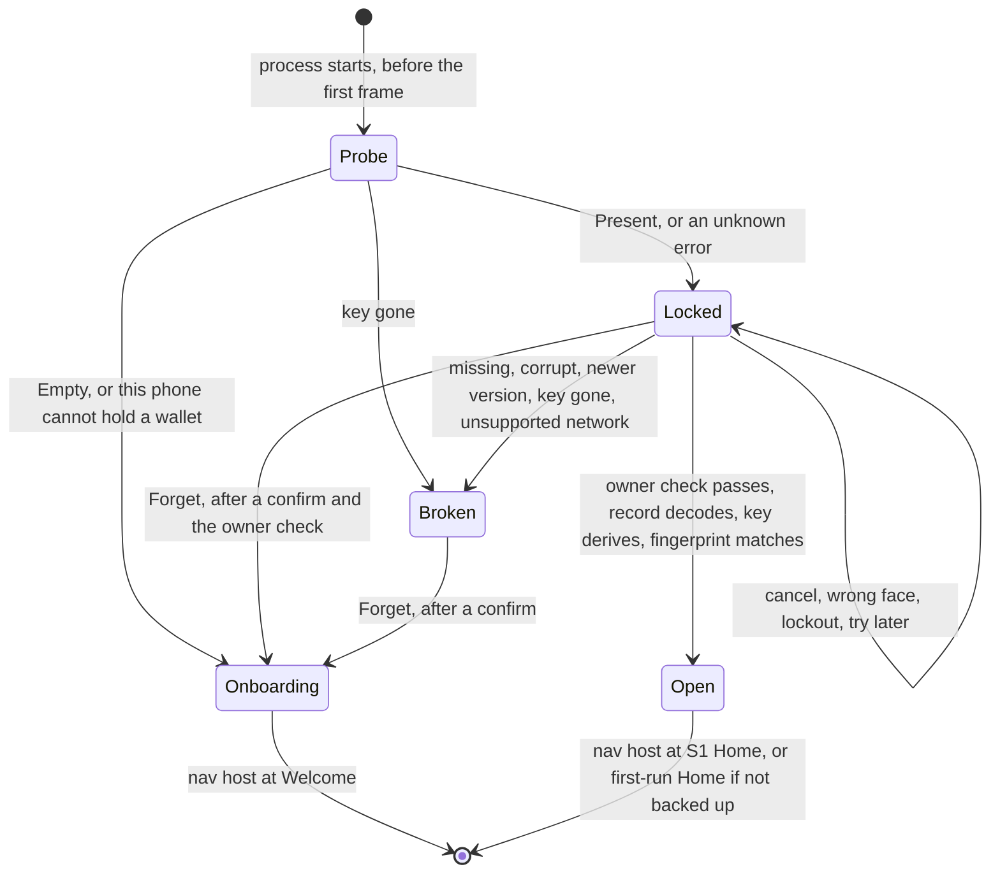

# Wallet storage on this phone (D1)

This page explains how the mebit app keeps a software wallet on this phone only, what it defends against, and what is still unproven. It condenses the D1 design notes (`design.md`, `outcomes.md`, `tests.md` and `sketch.kt` in `.audit/d1-secure-storage/synthesis/`, which are not committed). The code lives under `vault-workspace/mobile-signer-ffi/app/shared/`. Paths below start there.

D1 is testnet only. `SavedWallet` refuses to save or open a `MAIN` record until a security review lifts that limit.

## The problem

Before D1 the app held the 24 words, the BIP-39 passphrase and three routing flags in Compose `remember` state. Every cold start landed on Welcome, so a user who closed the app had to import the words again. D1 keeps that state on this phone only, so a restart opens an unlock screen instead.

Five parts of the app had to meet for that to work, and none of them touched each other before:

- a write point inside `OnboardingSession`, which has five mutators and stages a passphrase import until its fingerprint is confirmed
- a start decision made before any session exists, because the nav host's back stack was seeded from the constant `MovieRoute.start`
- a way to start locked, while `AppLockState` and its test pin an in-session lock that starts unlocked
- a load path that sets the three flags from the record, not from how the key was made
- an Android owner check, which step 7 added as `rememberBiometrics()` over the store's prompt

One more fact decided the layering. `SingleSigHome` binds even with an empty session and then shows the 1,250,000 sat demo fixture. So nothing that reads the session may exist before the wallet is open.

## How a cold start is decided

`WalletGate` (`src/navigation/WalletGate.kt`) runs before the nav host exists. It shows Welcome, the unlock screen, the recovery screen, or the nav host at a Home route. The nav host and every screen in it are composed only after the wallet is open or there is none.

`coldStart(probe)` and `startRoute(backupConfirmed)` in `src/navigation/ColdStart.kt` are pure and total. An unknown error goes to Locked, never to Welcome, because it may hide a saved wallet. `AppLockState` did not change. It still means the in-session lock after 60 seconds away, and it starts unlocked because the nav host that owns it does not exist until the wallet is open.

The layers, from the platform up:

| Layer | File | What it owns |
|---|---|---|
| `SecureStore` | `src/SecureStore.kt` | The only platform seam. Six methods on bytes: `probe` and `marker` never prompt, `read` may show the OS sheet, `write` never prompts and is all or nothing, `erase` is idempotent, `writeMarker` reports whether it took effect. Results are closed enums with no free text. Each store counts its copies in memory (`CopyCounter`, one per process, never written to disk): a read returns the copy's `StoreVersion` with the bytes, a `Replace` names the version it expects, and a store refuses a stale one with `Conflict` under its lock before any Keychain or file call. |
| Keychain store | `src@ios/SecureStore.ios.kt` | The iOS actual. It keeps the wallet in one of two fixed Keychain accounts, and a marker file. |
| Keystore store | `src@android/SecureStore.android.kt` | The Android actual. It keeps the wallet in one envelope file under a Keystore key pair, and no marker. Its sheet is `askOwner` in `src@android/OwnerPrompt.android.kt`. |
| `SavedWallet` | `src/data/SavedWallet.kt` | The record codec and its version, the testnet guard, the mapping of platform results to `UnlockResult` and `SaveResult`, and the reinstall rule (`start()` with the pure `reinstallPolicy`). The only code that calls `SecureStore`. |
| `OnboardingSession` | `src/data/OnboardingSession.kt` | One write point (`persist()`), `install`, `proveSavedCopy`, `forgetSavedWallet`, `flushPendingSave`, `recordUnconfirmedSend` and `clearUnconfirmedSend`, and the `saved` and `notSavedBecause` state that screens read. `saved` is derived from one private state that holds the version of the copy this session last read or wrote, so a cold start can only `Create`, and a session whose `Replace` met `Conflict` goes stale: it keeps the key in memory, shows the not-saved notice and writes nothing more in that run. |
| `PendingPayments` | `src/data/PendingPayments.kt`, `src/PlainFile.kt` and its two actuals | The pay-twice guards since commit `2dc1c72`, one line per wallet by master fingerprint (since `01c3e57` with the pending payment's signed transaction as a fourth field, checked against its txid), in a plain file outside the secure store that no backup copies. On Android it is `noBackupFilesDir/scan/pending-payment`, written through `AtomicFile` and read back. On iOS it is `Application Support/mebit/scan/pending-payment`, written atomically in a folder that carries the backup exclusion. One lock for the whole process covers every read, check and write. A file that cannot be read, or holds text it never writes, is damaged. It reads as a payment of unknown outcome for every wallet (`DamagedGuard`), refuses every claim, and only the user's clear deletes it. Forget never touches the file. |
| `WalletGateState` | `src/navigation/WalletGateState.kt` | The boot state, `unlock`, and an owner-checked `forget`. |
| `WalletGate`, `UnlockScreen` | `src/navigation/WalletGate.kt`, `src/feature/onboarding/UnlockScreen.kt` | The composables. `UnlockScreen` never holds a record and shows no word or fingerprint. |

## What the phone stores

`WalletRecord` (`src/data/WalletRecord.kt`) is the only stored type. It is a plain class with a redacted `toString`, so no generated method can print the words.

| Field | Why it is stored |
|---|---|
| `words`, `passphrase` | Every hot-wallet call needs both, byte for byte. Each is length-prefixed in the codec. |
| `backupConfirmed`, `imported`, `appLockEnabled` | The flags that choose the start route and the in-session lock. |
| `network` | Saved and loaded as `TEST` only. |
| `fingerprint` | A check value. `install` derives the key again and refuses a record whose fingerprint differs, so a damaged passphrase byte cannot open a different, empty wallet. |

The codec header holds the magic `MB` and a version byte. A newer version, an unknown flag bit or an unknown network byte decodes as `Newer` and is never overwritten. Flag bit 8 marked an optional section after the passphrase that held the pay-twice guard until commit `2dc1c72` moved the guard to its own file. Decode still reads that section under the same rules and hands its guard to the unlock, which moves it to the guard file once. Encode never writes the section, so every record saved since has the bytes a record had before the section existed, and an older build opens it. The phone stores nothing that the chain or the session can rebuild: balance, address, history, wallet mode, `lastTxid`, the keyring, drafts and quiz state.

### A payment of unknown outcome across a restart

A payment goes out in two steps on `SingleSigWallet` (`src/data/SendSession.kt`), and only the second writes the guard. Commit `b012f01` split the single `broadcast` into these steps, so that Review can show the real fee before anything is posted.

`prepare` signs the payment and posts nothing. It calls `hot_prepare_send_at_rate`, or `hot_prepare_send_all` when the user sends everything, and holds the result in `heldSend` together with the network it was signed for. It writes no guard. A payment already held is replaced, because nothing of it is out. While the guard is set, `prepare` refuses. A `dropHeldSend` that runs while the core is still signing advances an epoch that `prepare` captured at its start, so that `prepare` returns false and holds nothing.

Review (`src/feature/send/SingleSigScreens.kt`) then checks the signed payment with `needsConfirmation`. It holds when the real fee is more than twice the fee Review showed and either more than a tenth of the amount the destination gets or at least `FEE_SURPRISE_SATS` (1,000 sat) over the fee shown, and, for send all, also when what leaves is at least 1,000 sat under the amount shown. The absolute threshold came from the review recorded in open item 78, which found a fee 483 times the estimate posted on one tap because a large payment never crossed the tenth. In that case Review shows a card with the real fee, the amount that leaves and the total. Its confirm calls `post`. Its cancel calls `dropHeldSend`, which lets the held payment go, and leaving Review does the same. Otherwise Review calls `post` right after `prepare`.

`post` first refuses, posting nothing and leaving that guard in place, when another payment's guard is already set. Otherwise it claims its guard through `session.recordUnconfirmedSend`, which calls `PendingPayments.claim`. The claim holds the process-wide lock while it reads the guard file, finds whether this wallet already has a guard there, and writes the file atomically with the new line. `Written` lets the post go. `Taken` means another live instance of this wallet, or a run before a restart, guarded a payment that may be out, so `post` adopts that guard and refuses. `Damaged` means the file is there but cannot be read or decoded, so it may hide any wallet's guard, and `post` takes it as a payment of unknown outcome (`DamagedGuard`) and refuses. `NotSaved` means there is no file to keep the guard in or the write failed, so `post` drops the held payment and stops before the post, and Review shows that reason under ยังไม่ได้ส่ง, because a post without a guard on the phone is the kill window the guard exists for. Only after `Written` does it call `hot_broadcast`. The guard needs no secure store, so the phone keeps it whether or not it could save the wallet. So no guard names a payment the user did not confirm, and no payment is posted without its guard on the phone.

After a restart the new `SingleSigWallet` reads the wallet's guard from the file at its first bind. While the guard is set, `prepare` refuses and Review keeps its sign button off. When the post returns, the payment is out and the guard clears. When the node refuses the transaction, or `hot_broadcast` refuses before it posts, nothing is out and the guard clears too. A `BroadcastUnknown` or any other failure of the post keeps the guard, because the payment may be out. The guard also clears when a bind whose history loaded lists the txid, and when the user clears it through the control on Send and Review, which the screen offers once the guard is two minutes old by the phone clock or has a negative age. The clock only decides when to offer that control. It never clears the guard. Each clear calls `session.clearUnconfirmedSend`, which drops the wallet's line only while it still names that txid, so a late clear never drops a newer payment's guard, and deletes the file once no line is left. The clear of a damaged file deletes it only while it is still damaged, and Send and Review offer that clear at once, because a damaged file has no post time to wait on. A clear the file cannot take leaves the line, so the next bind takes the guard again and the wallet keeps refusing until a clear goes through. That errs on the side of never paying twice.

Since `01c3e57` a payment of unknown outcome can be posted again with the same bytes (open item 79, option C2). `post` keeps the signed transaction beside the guard when its double SHA-256 is the guard's txid, and Send and Review then offer ส่งรายการเดิมอีกครั้ง at once, behind the same owner check as signing. `PendingPayments.repost` reads the bytes from the file under the process-wide lock only while the line still names that txid, marks the txid as being posted so that no settle in any instance drops it meanwhile, and posts outside the lock. The same bytes are one transaction, so a retry cannot pay twice, and the core checks them against the txid again before it posts. Only an answer that the payment is out, which includes the node saying it already holds or already mined it, drops the guard. A retry that ends unknown, is refused or fails any other way keeps it, because a refusal of a retry can mean that the first post already confirmed. A line of three fields, written before `01c3e57` or moved from flag 8, and a damaged file get no retry. Bytes that are not their line's transaction make the file damaged. Since `c03d0c2` the draft of a payment that a retry put out is dropped in the same step that learns it is out, so leaving Send or Review while a retry runs cannot leave it behind for a second signing, and Send, like Review, cannot be left until the retry ends. An adversarial review proved that before this a user who left Send mid-retry could pay the same payee twice.

A record saved before `2dc1c72` may still hold a guard in its flag 8 section. The unlock hands it to `install`, which claims it into the file before any other save. Once the file holds a guard for that wallet, the record is saved again without the section, so a later unlock finds nothing to move. A guard the file already held for that wallet wins over the old record's. Since `af6f1df` the old record's guard (`recordGuard`) stays until a record save without the section succeeds, so a failed save never lets a payment the user cleared come back. A file that holds another payment for that wallet, a damaged file, or one that cannot take the guard all keep it in memory and in the old record, every payment is refused, and each write point and the foreground flush try the move again. Its clear is all or nothing. The record is saved without the section first, and a clear that cannot do that keeps every copy and says so on the card. `forgetSavedWallet` never touches the guard file, so the same words imported again take their guard back and refuse until it settles or the user clears it, and another wallet never meets it. A forgotten wallet's line, its fingerprint, txid and time, stays on the phone until then. Before `af6f1df` Forget erased every line, and an adversarial review proved that the recovery screen's way back then let the same wallet pay twice. Since `c03d0c2` every Forget goes through `forgetSavedWallet`, which first moves an older record's flag-8 guard into the guard file and refuses, erasing nothing, when it cannot: a damaged file, a failed write, or another payment of that wallet already in the file. That covers the unlock screen's link, the recovery screen (including a record that opens but fails to install) and the session's own Forget. A record that cannot be read at all cannot show a guard and is erased as before. A clear whose file write or delete fails now says so and keeps the guard.

### The scan file, an approved exception

On 5 Nov 2026 the user approved one exception to the rule that the phone stores nothing the chain can rebuild. The hot wallet keeps a scan file per wallet (`rust/src/scan_store.rs`, commit `222e384`), named by the account id and written atomically by Rust. It holds, per chain, the highest index proven used and for each index asked a few flags (used, confirmed, pending, funded), plus when the last full pass started and whether it ended. It holds no key, word, address, amount or txid. One test checks that the file names no txid, block, address or amount the explorer served, and the review fixes (`4a9be87`, file version 2) removed a change token that gave each amount back by brute force. The file is outside data, so the index it names backs nothing until a source proves that address used again with the same proof a scan makes. An index that does not hold sends its chain back to index 0. It lives in app storage that is not backed up, which is `noBackupFilesDir/scan` on Android and `Application Support/mebit/scan`, excluded from backup, on iOS. Kotlin passes the folder once from `WalletGate` and erases every scan file in `forgetSavedWallet` after the saved wallet is erased. An unreadable, foreign, older or newer file is ignored and discovery starts over, which costs requests and never coins. The file lets a refresh after a restart, a payment or a lost host ask only funded, pending and look-ahead addresses and the proven one. That was 12 requests for the 24-word test wallet instead of 368, measured before the review fixes, which add five reads per chain to the first refresh after a launch. Root or a jailbreak that edits the file can still name a real payment past a gap, which then stands as the frontier, or clear a funded flag, which hides that balance until the next full pass, 6 hours on a public explorer. Tests ran both, and they fall under the threat model's root row. Since `513c722` the address the wallet hands out never passes what a gap-20 restore over the host's confirmed answers reaches, once the host has answered a whole gap of 20 indices with no confirmed history. A gap that a reorg or a forged lower proof leaves below a proven payment is bridged by handing out the farthest address that restore still asks, and a routine sync asks that address again, so a payment to it confirms the bridge. A lying host's false confirmed claim below the frontier can still lift the cap, a reorg that undoes an emptied lower payment shows only at the next full pass, and a pass cut short before the gap hands out the uncapped address until a pass reaches it. An adversarial review proved the gap (open item 83). A phone with no screen lock keeps the wallet in memory but still writes this file, which holds nothing secret.

## iOS keeps one Keychain item and a marker file

- The item is a generic password under service `com.mebit.app.wallet`, account `wallet.a` or `wallet.b`, with `kSecAttrSynchronizable` false and `SecAccessControl(kSecAttrAccessibleWhenPasscodeSetThisDeviceOnly, .userPresence)`. It never syncs, never enters a backup, stays on this phone, needs a passcode to exist, and the OS deletes it when the passcode is removed. It uses the default access group and no entitlements file.
- On an iPhone the item cannot be listed both silently and usefully. On 2 Nov 2026 an iPhone 15 answered an attributes-only list under an `LAContext` whose `interactionNotAllowed` is true with `errSecInteractionNotAllowed` (-25308) and no item, although the item was there. The same list with no context returned the item after 3 to 4 seconds, probably behind a Face ID sheet. A simulator lists the item either way. So only `probe` and a Create's existence check list, and `read` and a Replace name the two accounts.
- `probe` lists silently, so the cold start never prompts before the unlock screen. A listed item is `Present` (a simulator). A refused list with no item is `Present` while the phone is unlocked (`UIApplication.protectedDataAvailable`), because only an item that needs its owner answers that way, and `TryLater` while the phone is locked, which answers the same. Nothing found is `Empty`, or `Unavailable(NoScreenLock)` on a phone without a passcode.
- `write` never calls `SecItemUpdate`, which may prompt for an item with this access control, and never prompts. A Create first checks with the probe's silent list and adds `wallet.a` only when the store is empty. It answers `AlreadyExists` for a wallet it lists or senses, and `Unavailable(TryLater)` on a locked phone. A Replace never lists. It adds to `wallet.a`, or to `wallet.b` when `wallet.a` answers `errSecDuplicateItem`, and then deletes the other account. When both answer duplicate it fails with `Unavailable(Other)` and changes nothing. So the wallet moves between the two accounts at each Replace.
- `read` waits up to 3 seconds for the app to be active, evaluates `deviceOwnerAuthentication` (Face ID first, the passcode inside the same card), and hands that context to a data-only read of `wallet.a` and of `wallet.b` (`EVALUATE_BEFORE_READ`). The iPhone answered such a read with no second sheet. A simulator enforces no Keychain access control, so without the evaluation it would show no card at all. One account with bytes is the wallet. Two (a Replace whose delete did not happen) are settled by each item's creation date, read only on that path: the read returns the later copy and deletes the other. With no bytes the read is `NotFound` when both accounts found nothing, else the first account's other answer. The store's lock is held only around the Keychain calls, never while the card is up.
- The marker file `Application Support/mebit/wallet-marker` holds `empty` or `kept`. It stays in backups on purpose, so a same-device restore keeps a good wallet. `reinstallPolicy(marker, probe)` decides the rest. A fresh install that finds an item left by a deleted install erases it and shows a one-time notice on Welcome. A probe in doubt never wipes.

## Android keeps one envelope under a Keystore key

Step 6 built the store behind the same seam, following `.audit/d1-secure-storage/android/spike-2026-11-03.md`:

- An RSA-2048 key pair in AndroidKeyStore under the fixed alias `com.mebit.app.wallet`. Every use of the private half needs the owner (`setUserAuthenticationParameters(0, AUTH_BIOMETRIC_STRONG or AUTH_DEVICE_CREDENTIAL)`). It also needs an unlocked phone (`setUnlockedDeviceRequired(true)`) and survives a new fingerprint. It is made in StrongBox first, and in the TEE on `StrongBoxUnavailableException`.
- One file, `noBackupFilesDir/wallet`, written through `AtomicFile`, so a reader sees the old copy or the new one. It holds `[MW, version 1][wrapped length][RSA-OAEP-wrapped AES-256 key][12-byte IV][AES-GCM ciphertext and tag]`, and the header is GCM's extra data. A write makes a fresh AES key, wraps it with a software copy of the public half and never prompts. Android needs no two-slot scheme, because its writes never prompt.
- A read shows one framework `BiometricPrompt` with the private half as its `CryptoObject`, through `askOwner` in `src@android/OwnerPrompt.android.kt`, which step 7 can reuse. The store's lock is never held while the sheet is up.
- `probe` checks the API level, then the file, then the key, then the screen lock. A file without its key is `KeyGone`, so a phone whose screen lock was removed reaches the recovery screen and not Welcome. No file and no screen lock is `NoScreenLock`.
- The key is made on a background thread when the probe finds no wallet on a phone with a screen lock, after an erase, or at a write that finds none. It is never made over a stored wallet's key. A write that arrives before it is ready answers `TryLater`, and the session saves again at its next write point or when the app returns.
- `erase` deletes the key and the file. `marker()` is `Unsupported`, so the reinstall rule never wipes. An uninstall removes the file and the key together.
- Below API 30 nothing is stored (`OsTooOld`), and the not-saved notice says so. `minSdk` stays 24.
- The manifest has `allowBackup="false"`, data extraction rules that exclude every domain from cloud backup and device transfer, `USE_BIOMETRIC`, and `launchMode="singleTask"` and `configChanges` on `MainActivity`, so a rotation does not rebuild the gate and ask again.

The pure decisions (probe, read, prompt error, unwrap, write, key generation, erase) and the envelope have 26 host tests in `test@android/KeystoreMappingTest.kt`.

## Threat model

| Adversary or event | Defended | How |
|---|---|---|
| Cloud and backup copies (iCloud Keychain, iCloud and computer backups, device transfer) | Yes | The item is `ThisDeviceOnly` and not synchronizable. A restore on another phone brings no wallet, and the user types the 24 words. |
| A lost or stolen locked phone | Yes | The item is unreadable while the phone is locked. |
| A thief with an unlocked phone opens mebit | Yes, at cold start | The read needs Face ID or the passcode. A thief who knows the passcode passes. |
| Someone with the unlocked phone taps Forget | Yes | While the copy still opens, Forget needs the OS owner check after the confirm. From the recovery screen the confirm alone erases, because nothing readable is left. |
| An item left by a deleted install | Yes | The first launch of a fresh install erases it, by the user's decision. |
| Another app on the phone | Yes | The sandbox and the default Keychain access group. |
| Code in the app's process before unlock | Yes, for the stored copy | The owner check runs inside the Keychain call, not in app code. |
| The words in memory after unlock | No | Kotlin strings cannot be wiped, FFI copies are not zeroed, and the 60-second lock is a UI gate. |
| Root, jailbreak, OS compromise, memory forensics | No | Out of scope. |
| Coercion, a watched passcode, phishing of the 24 words | No | Out of scope. |
| The OS deleting the item when the passcode is removed | No | Outside the app's control. The next launch says the wallet is gone. |

## Decisions the user made

1. Save every wallet when it is made, and always ask for the owner at launch, even when the user skipped the App Lock step.
2. On iOS a reinstall wipes the old copy, the same as an Android uninstall. Key Created now says that deleting the app removes the wallet from this phone and only the 24 words bring it back. The cost is accepted. An accidental delete before the words were written down loses the wallet for good.

The design proceeds with these defaults until someone decides otherwise. Forget needs the owner check while the copy still opens. The phone's passcode counts as the owner check. A phone with no passcode keeps the wallet in memory only and shows a notice. A cold unlock opens S1 Home when the backup is confirmed and the first-run Home when it is not.

## Outcomes by group

`outcomes.md` lists 78 cases. Two rules hold in every row. Only `forgetSavedWallet()`, after a confirm, deletes the saved copy. A failed write keeps the key in memory and says it is not saved.

| Group | Rows | What the user sees |
|---|---|---|
| Start and read | 1 to 11 | Welcome when nothing is saved or the phone cannot hold a wallet. Otherwise the unlock screen. A cancel, a wrong face, a lockout or a busy phone keeps it locked and installs nothing. |
| Key loss and platform changes | 12 to 19 | A removed passcode, a backup restored on a new phone, or an iOS reinstall opens Welcome with a one-time notice. A record left without its key (Android) opens the recovery screen. |
| Damaged, newer and unsupported records | 20 to 26 | The recovery screen, which offers Forget and an import of the 24 words. A newer record is never overwritten. A missing native library crashes on purpose instead of offering to delete a good wallet. |
| Writes | 27 to 36 | A failed first save shows the not-saved notice and is tried again at the next write point and when the app returns. A failed later save keeps the earlier copy, under the same copy version, so its retry is not a Conflict (row 27). Create never overwrites a saved wallet. In row 33 another instance's Forget and Create advance the store's copy counter, so the first instance's stale Replace answers Conflict before any Keychain or file call: the new wallet stays, and the first instance keeps its key and flags in memory and shows the not-saved notice. |
| Process and screen lifecycle | 37 to 42 | A killed app asks again at the next launch. Forget asks for a confirm, then the owner. A failed erase keeps the wallet and the screen. |
| Added by the synthesis and the reviews | 43 to 66 | The owner-checked Forget, the Enable read-back, the reinstall rule's edge cases, and the foreground flush. Row 52 is a payment of unknown outcome across a restart, which step 9 keeps refusing. A Conflict is another way the phone's copy can lack this run's latest flag or payment of unknown outcome until the next launch (rows 66 and 67). |
| Added by step 9 | 67 to 71 | A failed save of a payment of unknown outcome, its settle, a phone clock that moves, an older build that meets the section, and Android, where a restart forgot it until the guard moved to its own file in `2dc1c72`. |
| Corrected by step 3c | 72 to 75 | A table of the earlier rows that failed on the iPhone because the store listed its item, then two copies in both Keychain accounts, their creation dates, and an item from a build before step 3c. The read that settles two copies does not advance the copy counter, so the writer of the newest copy keeps saving (rows 28 and 72). |
| Added by the compare-and-swap Replace | 76 to 78 | Two live instances opened the same wallet and one saved a newer copy, a flag or, before `2dc1c72`, a payment of unknown outcome: the other's Replace answers Conflict and the newer copy stays (row 76). Another instance forgot the wallet and saved nothing new: the stale Replace answers Conflict, later write points write nothing, and the forgotten wallet stays forgotten on the phone while the key stays in that instance's memory until the process ends (row 77). One session never meets a false Conflict, because a Replace that answered Unavailable, a Replace that met both Keychain accounts taken, and the read that settled them do not advance the counter (row 78). |

Only these rows destroy data. Row 17 erases the orphan of a deleted install, by the user's decision. Row 18 is the user's own Android uninstall. Rows 41, 44 and 75 are a confirmed Forget. Row 54 erases a good wallet if the marker is lost without a reinstall. The 24 words recover every one of them. Rows 72 to 74 delete only a second copy of the same wallet, and a wrong pick there drops at most its latest flags or payment of unknown outcome. Row 33 no longer destroys data: the stale Replace is refused.

## What has been proven

- Step 1, the pure core, has 38 tests for the codec, the store results, the cold start and the reinstall rule, and 13 mutations of it were caught.
- Step 2, the session, has 19 tests for the write point, staging, refusal to replace and the Enable read-back.
- An adversarial review by three models of steps 1 and 2 found three root causes, all fixed in `046f706`. A model checker replayed 992,784 event sequences, and a fuzz of 300,000 decode inputs never threw.
- Step 3, the Keychain store (`62eb596`), has 28 tests of its pure decisions. A harness ran 81 checks on an iOS 26.5 simulator, including a real `simctl uninstall` and reinstall that wiped the orphan once.
- In step 3b (`12d634c`) the owner check before the Keychain read shows the Face ID card on a simulator, and a store probe returned in 10 ms while the card was up.
- Step 4a: `WalletGateState` has 13 tests, including 1,000 seeded random walks, with 15 mutations caught.
- Step 4b, part 1 (`dedd874`, `32a3cd1`), wired the gate, the unlock and recovery screens, Forget and the Welcome notice, and drove them on a simulator and an Android emulator.
- Step 4b, part 2, added the not-saved notice, the delete warning on Key Created and the Enable read-back. The three pure functions (`notSavedText`, `readBackScan` and `goesOnWithoutLock`) have 12 tests, and 17 one-rule mutations of them were all caught. On an iPhone 17 Pro simulator (iOS 26.5), 118 driven steps passed with none failing: the read-back card at Enable, a miss and a cancel, a cold start that reopened the same key, the reinstall wipe, Forget, and the notice for a store that refused writes or read back a different copy. That run found that after a failed read-back the primary button showed the line for a phone without Face ID, and its link then turned the lock on. `goesOnWithoutLock` (`src/feature/onboarding/ReadBackScan.kt`, `4e31121`) now goes straight on without a lock. A second simulator run with the same probe showed first-run Home with the notice, and the lock still off after 80 seconds away. The simulator's keychain database showed one item of class `akpu`, not synchronized. On the Android emulator, 20 steps passed: the notice on Key Created and Home, and Welcome after a relaunch. `vault-workspace/mobile-signer-ffi/app/.claude/skills/verify/features/wallet-restart.md` holds the commands.

- Step 9 stores a payment of unknown outcome with the wallet. Thirteen new tests and four extended ones cover the codec section, the session's write point and the wallet across a restart, and 18 one-rule mutations of that code were all caught. On an iPhone 17 Pro simulator (iOS 26.5), with a throwaway probe that made a key's bind live and its broadcast end in `BroadcastUnknown`, Send still showed PAYMENT UNCONFIRMED and Review still refused to sign after a kill, a relaunch and the unlock. Two minutes after the broadcast a bind settled the payment, and Send accepted the same payment again. The keychain item was replaced at the broadcast and again at the settle. `vault-workspace/mobile-signer-ffi/app/.claude/skills/verify/features/wallet-restart.md` holds the commands.

- The first iPhone session (2 Nov 2026, an iPhone 15 with iOS 27.0.1, a signed debug build of `cdb04dd` with a throwaway logging patch) proved three things and broke one. The Keychain add of this item showed no sheet. `evaluatePolicy` passed, and a data read of a known account with the evaluated context then returned the item 10 ms later with no second sheet, so one read shows one card. A data read with a fresh context showed the Keychain's own sheet once. But the store's silent listing answered -25308 and no item while the item was there, so the unlock screen and the Enable read-back both said try again. `.audit/d1-secure-storage/phone/evidence-2026-11-02.md` holds the log.

- Step 3c keeps the wallet in `wallet.a` or `wallet.b` and lists only in `probe` and a Create's check. `KeychainMappingTest` has 47 tests of the store's pure decisions, 14 of which failed first against stubs, each on the predicted disagreement. Twenty-four one-rule mutations were all caught. A throwaway harness passed 44 of 44 checks twice on an iOS 26.5 simulator, every read through the real Face ID card: the account alternated at each Replace, two copies in either order settled to the later one, and a Replace with both accounts taken changed nothing until a read settled them. On an iPhone 17 Pro simulator the real UI created a key (one item in `wallet.a`), enabled the lock (one item in `wallet.b`), reopened the same key after a kill and a relaunch, enabled the lock again from the catalog (one item in `wallet.a`), forgot the wallet after a missed face and the owner check, and wiped the item left by `simctl uninstall` at the reinstall's first launch, with the Welcome notice once. The simulator lists the item, so the refused listing is covered by the pure tests only.

- The second iPhone session (3 Nov 2026, the same iPhone 15, a signed debug build of `7477818` with a throwaway status-logging patch that changes no logic) ran the step 3c store end to end, and every step passed. At the first launch after a delete and a reinstall the probe read its refused list (-25308) as a wallet, `SecItemDelete` of the old item answered 0 in 4 ms with no sheet, and Welcome showed the one-time notice. Create added `wallet.a` silently. Enable cost one Face ID scan. The read of `wallet.a` returned its 173 bytes, the read of the empty `wallet.b` answered not found in 4 ms with no prompt, and the Replace added to `wallet.b` after `wallet.a` answered duplicate, then deleted `wallet.a` silently. After a kill and a relaunch the probe said Present, one scan unlocked the wallet from `wallet.b`, and the fingerprint matched the one shown at creation. After 70 seconds away the unlock screen appeared, so the lock flag written by that Replace survived. A missed face and Cancel left the unlock screen with its button and no error line, and a Forget with one owner scan erased the item with status 0 and opened Welcome. `.audit/d1-secure-storage/phone/` holds both logs and the evidence notes.

- Step 6, the Android Keystore store, has 26 host tests (`KeystoreMappingTest`). The first 24 tests all failed against stubs. Two more were added when a mutation survived or would have. Twenty-six one-rule mutations were all caught (`.audit/d1-secure-storage/android/mutate.py` reruns them). On the `Medium_Phone_API_36.0` emulator (API 36, PIN 1234, a software Keystore), the real UI ran as follows on 3 Nov 2026. Key Created showed the delete warning and no notice, and the wallet file held 459 bytes. App Lock Enable read the copy back through one PIN prompt. After a force-stop and a relaunch, the unlock screen showed the prompt, and the PIN opened first-run Home with the same fingerprint. The system logged one auth session with `IsCrypto: true`. Cancel left the unlock button and no second prompt. A rotation while the prompt was up kept one session. With the PIN removed the next launch showed the recovery screen, and Forget erased the file without a prompt. With no screen lock a new key showed the NoScreenLock notice. An uninstall and a reinstall opened Welcome.
- Step 7, Android `Biometrics`, made `platformBiometrics()` the composable `rememberBiometrics()` and backs the Android actual with the store's `askOwner` sheet without a crypto object (a strong biometric or the screen lock). `androidBiometricOutcome` maps the sheet's answer through the store's `androidPromptOutcome`, and it has 5 host tests (`AndroidBiometricsTest`). Three failed against a stub that kept the old answer, and the two that passed check the Unavailable rules the stub already met. Five one-rule mutations were all caught. On the same emulator on 3 Nov 2026, Enable took one PIN prompt (`IsCrypto: true`). After 65 seconds away the same process showed the unlock screen with the prompt up, and the PIN opened Home: the case step 6 left stuck. Cancel (error 10) left the unlock button with no error line and no second prompt. The sign check showed the prompt over Review. Cancel gave the refusal banner with nothing signed, and the PIN let signing go on (a throwaway probe supplied the balance).

- The compare-and-swap Replace (3 Nov 2026) added `StoreVersion` and `CopyCounter` to the seam, `Conflict` to the write and save results, and the session's one held state. Its three race tests (`OnboardingSessionSaveTest.aStaleReplaceNeverBringsBackAForgottenWalletOverANewOne`, `aStaleReplaceNeverOverwritesANewerCopyThatHoldsAPayment` and `aStaleReplaceAfterAForgetElsewhereNeverSavesTheForgottenWalletAgain`) were written against the earlier code first and failed on the predicted assertions: the saved copy held the forgotten wallet's check value, the payment of unknown outcome read back as null, and the forgotten wallet's probe read Present. Four no-false-Conflict tests, two `SavedWalletTest` tests, three `CopyCounterTest` tests, the version pass-through in both platform mapping tests and a host test that pins one Android process and `singleTask` on `MainActivity` came with them. Three one-rule mutations were all caught: a counter that advances on an Unavailable write (3 tests), a read-back that adopts the version it read (1 test), and a Replace that ignores its expected version (6 tests). The real Keychain and Keystore under a stale Replace are unrun. The harness checks below are owed.
- The guard file (5 Nov 2026, `2dc1c72`) came with six new tests and changes to the codec, session, wallet and send-text tests, written against the earlier code first, where 26 failed for the predicted reasons. One-rule mutations were each caught: a post before the claim (22 tests), no process-wide lock, a Forget that skips the erase, an install that skips the move, a save that drops an unmoved guard, a guard not keyed by fingerprint, and a clear that ignores the txid. The two-instance race test passed 1,000 of 1,000 runs and failed 100 of 100 against a lock per instance. Its first version failed about 6 runs in 100 because its two posts did not overlap, which the test now forces. An emulator probe on API 36 drove the real Android file through a claim, a second wallet, a settle, an erase and a damaged file.

The Kotlin/Native test executable gets `errSecMissingEntitlement` for every Keychain call, so no unit test touches the real Keychain. Those proofs are the simulator runs and the two iPhone sessions.

## What each platform still owes

The iPhone sessions of 2 and 3 Nov 2026 settled most of this list. A read shows one card, a signed debug build runs, and the store's create, read, Replace, Forget and delete all work on a device with no extra sheet. A delete and reinstall opens Welcome with the notice. The iPhone still owes:

- a Replace from `wallet.b` to `wallet.a`, which only the simulator has run, because the one Replace on the phone went from `wallet.a` to `wallet.b`
- whether the attributes-only read of the creation dates with the evaluated context is silent. Only two copies reach it, after a Replace whose delete did not happen, and the phone never made two copies.
- a probe and a Create on a locked phone, which must answer try later
- a failed face that falls through to the passcode inside the store's card
- a kill while the card is up
- removing the passcode, which must make the next launch say the wallet is gone
- a cold start that stays inactive longer than the 3-second wait. Every cold start on the phone showed the card at once.
- the compare-and-swap Replace on a simulator or the phone: Create X and keep its version, erase, Create Y, then a Replace of X with the old version must answer Conflict, and the read through the Face ID card must return Y from `wallet.a` with `wallet.b` empty. This is the exact ABA of row 33.

Android has step 6, built and proven on an emulator only. It still owes:

- the same compare-and-swap sequence through `KeystoreStore(activity)` and `KeystoreStore(activity.applicationContext)`, which proves the copy counter is process-wide and not per instance

- step 7 (`Biometrics`) on hardware. It is done and proven on the emulator only. A fingerprint, a real lockout (codes 7 and 9, which the emulator never sent with the PIN allowed), API 30 to 32 and MIUI's sheet are unrun.
- the POCO X3 NFC round with a person (Android 11, MIUI, a TEE and no StrongBox): the key's security level and generation time, whether the `CryptoObject` prompt with the screen lock works on API 30, a fingerprint read, Cancel, a lockout, and whether removing the PIN also deletes the key there
- API 30 to 32, where the Keystore error code 10 cannot be read, so a wrapped key that is not this one reads as try again, not as damage
- StrongBox generation and its time, on a phone that has one, such as the Galaxy S25 FE
- face unlock, Smart Lock and trust agents with `setUnlockedDeviceRequired`
- a real `KeyPermanentlyInvalidatedException`, which the emulator never sent

## Known gaps

- A stale `Replace` from a second live instance (outcomes row 33) is now refused: every store counts its copies in memory, a `Replace` names the copy it expects, and `OnboardingSessionSaveTest.aStaleReplaceNeverBringsBackAForgottenWalletOverANewOne` pins it.
- Only the app's own process writes the store, and a second writer process would bypass the copy counter. None exists, and `AndroidManifestTest` pins that no element sets `android:process` and `MainActivity` stays `singleTask`.
- A Forget from the unlock screen whose erase fails reads as "cannot open now", not as a failed erase.
- A failed erase advances the store's copy counter like any erase, and `EraseResult.Failed` carries the new version. A session whose Forget failed adopts it, so its later saves, the payment guard included, are not refused as a Conflict. `OnboardingSessionSaveTest.aFailedForgetLeavesTheSessionAbleToSaveItsPaymentGuard` pins it.
- The Welcome notice shows again if the user returns to Welcome in the same launch.
- A user whose probe was in doubt may scan Face ID and then see the recovery screen for a missing item, because the face check now comes before the store looks for an item.
- A Replace that finds both Keychain accounts taken fails until a read settles them, so a flag change in that window is saved only after the next unlock (outcomes row 72). Two copies whose creation dates cannot be read, or a phone clock moved back between their adds, keep the wrong copy. Both copies hold the same wallet, so that loses at most its latest flags (rows 73 and 74).
- An item that a build before step 3c wrote (`wallet.<generation>`) opens the recovery screen, where Forget erases it, and a fresh install wipes it (row 75). Only development installs hold one.
- If the last flag write fails and nothing writes again before the app is killed, the stored `appLockEnabled` can be stale after a restart. The payment guard has no such gap, because a guard the file cannot take stops the payment before the post.
- A phone clock moved after a broadcast of unknown outcome changes only when Send and Review offer the clear control: moved forward, the control shows early; moved back, the guard's age is negative and the control shows at once. No clock setting clears the guard, and no clock setting keeps the user from clearing it after checking the explorer. A history that lists the txid still settles the payment at once.
- Since `2dc1c72` the guard needs no secure store, and since `da252a2` a phone with no owner check, which has no screen lock or runs Android below 11, sends past the session Spending PIN of open item 79 (`src/data/SpendingPin.kt`). Each gate reads the phone's owner check at that moment, never the saved state, so a run in which the screen lock is removed after the wallet was saved asks for the PIN too. When that run has no PIN yet, whoever holds the phone at the next gate sets it. The PIN lives in memory as a salted SHA-256 beside the words and is never written. Since `ac030cf` the 60-second lock and the PIN's waits run on a clock that counts deep sleep, `SystemClock.elapsedRealtimeNanos` on Android and `CLOCK_MONOTONIC_RAW` on iOS. Before it, Android's clock stopped in deep sleep, so a phone asleep for the whole minute could skip the lock. No phone that really slept has run it. An Android emulator (API 36, run `20261105-212952`) and an iOS simulator (iOS 26.5, run `20261105-221653-ios`, with a throwaway probe that reports no owner check) ran every gate. No Android 10 or older ran. A session restored from a saved wallet on a phone that reports no owner check has no 60-second lock until its first gate sets a PIN. A real phone without a lock saves no wallet, so only the probe reached that state.
- Since `af6f1df` a damaged or unreadable guard file reads as a payment of unknown outcome for every wallet. Send shows PAYMENT UNCONFIRMED and offers the clear at once, the card says the record of the earlier payment is damaged, and the clear deletes the file, so no phone needs a reinstall. Before it, Review showed only its general failure banner and the user had no way out (iOS run `20261105-221653-ios`). A failed guard write now shows its reason on Review under ยังไม่ได้ส่ง. An Android emulator ran both (run `20261106-000122`). On iOS a scan folder that cannot be made or marked as excluded from backup stops every payment, on a phone with a lock too, which is read from the code.
- A Forget refused on the recovery screen because the guard file cannot take an older record's guard has no way out in the app until the file recovers, since the damaged-file clear lives on Send and Review. Only a phone that ran a build before `2dc1c72` can reach it. After a retry goes out on Review, its summary shows the emptied draft, which is cosmetic. The rule that Send cannot be left while a retry runs has no UI test, because the module has no Compose UI test support, and no emulator has run it.
- Since `01c3e57` the guard file holds the signed transaction of a pending payment, so a reader of app storage sees that payment's amount and address until it settles or is cleared.
- Since `af6f1df` no other gate can take the 60-second lock's PIN sheet, and the PIN sheet and the lock cover read as dialogs to screen readers and hide the app behind them. Android emulator dumps show it. The iOS side of that is unverified.
- The iOS guard file ran on a simulator in run `20261105-221653-ios`. The post wrote one line, `<fingerprint> <txid> <seconds>`, before it posted. A restart brought PAYMENT UNCONFIRMED back from the file, and the clear deleted it. The `scan` folder carries `com.apple.metadata:com_apple_backup_excludeItem`. No phone has run it, and the Android file ran in an emulator probe on API 36.
- `persist()` is serialised by a lock, so a foreground flush and another write point cannot interleave. `OnboardingSessionSaveTest.aSaveHeldInTheStoreDoesNotLetALaterSaveBeOverwritten` pins it.
- The keyring, vaults, paired devices and the Trezor pairing credential do not survive a restart.
- No Penpot board exists for the unlock screen, the recovery screen, the Forget sheet, the Welcome notice, the not-saved notice or the delete warning. `docs/04-open-items.md` lists them with their Thai copy.

## Next steps

1. Run the POCO X3 NFC round, which now covers steps 6 and 7, before step 6 ships.
2. Optionally hide the screen under the in-session lock from accessibility (step 8).
3. Have the security review read D1, including the Android envelope, before the testnet-only limit is lifted.
