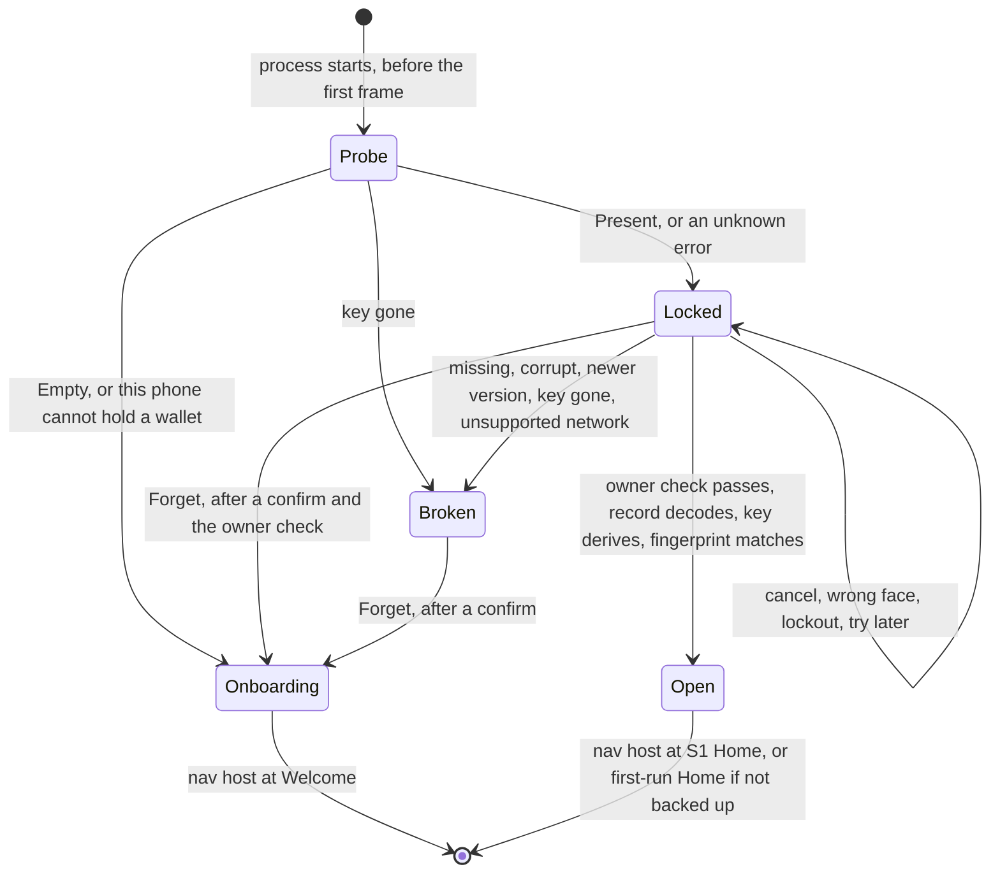

# Wallet storage on this phone (D1)

This page explains how the mebit app keeps a software wallet on this phone only, what it defends against, and what is still unproven. It condenses the D1 design notes (`design.md`, `outcomes.md`, `tests.md` and `sketch.kt` in `.audit/d1-secure-storage/synthesis/`, which are not committed). The code lives under `vault-workspace/mobile-signer-ffi/app/shared/`. Paths below start there.

D1 is testnet only. `SavedWallet` refuses to save or open a `MAIN` record until a security review lifts that limit.

## The problem

Before D1 the app held the 24 words, the BIP-39 passphrase and three routing flags in Compose `remember` state. Every cold start landed on Welcome, so a user who closed the app had to import the words again. D1 keeps that state on this phone only, so a restart opens an unlock screen instead.

Five parts of the app had to meet for that to work, and none of them touched each other before:

- a write point inside `OnboardingSession`, which has five mutators and stages a passphrase import until its fingerprint is confirmed
- a start decision made before any session exists, because the nav host's back stack was seeded from the constant `MovieRoute.start`
- a way to start locked, while `AppLockState` and its test pin an in-session lock that starts unlocked
- a load path that sets the three flags from the record, not from how the key was made
- an Android owner check, which does not exist yet

One more fact decided the layering. `SingleSigHome` binds even with an empty session and then shows the 1,250,000 sat demo fixture. So nothing that reads the session may exist before the wallet is open.

## How a cold start is decided

`WalletGate` (`src/navigation/WalletGate.kt`) runs before the nav host exists. It shows Welcome, the unlock screen, the recovery screen, or the nav host at a Home route. The nav host and every screen in it are composed only after the wallet is open or there is none.

`coldStart(probe)` and `startRoute(backupConfirmed)` in `src/navigation/ColdStart.kt` are pure and total. An unknown error goes to Locked, never to Welcome, because it may hide a saved wallet. `AppLockState` did not change. It still means the in-session lock after 60 seconds away, and it starts unlocked because the nav host that owns it does not exist until the wallet is open.

The layers, from the platform up:

| Layer | File | What it owns |
|---|---|---|
| `SecureStore` | `src/SecureStore.kt` | The only platform seam. Six methods on bytes: `probe` and `marker` never prompt, `read` may show the OS sheet, `write` never prompts and is all or nothing, `erase` is idempotent, `writeMarker` reports whether it took effect. Results are closed enums with no free text. |
| Keychain store | `src@ios/SecureStore.ios.kt` | The iOS actual. It keeps the wallet in one of two fixed Keychain accounts, and a marker file. |
| `NotWired` | `src@android/SecureStore.android.kt` | The Android actual until step 6. It stores nothing. |
| `SavedWallet` | `src/data/SavedWallet.kt` | The record codec and its version, the testnet guard, the mapping of platform results to `UnlockResult` and `SaveResult`, and the reinstall rule (`start()` with the pure `reinstallPolicy`). The only code that calls `SecureStore`. |
| `OnboardingSession` | `src/data/OnboardingSession.kt` | One write point (`persist()`), `install`, `proveSavedCopy`, `forgetSavedWallet`, `flushPendingSave`, `recordUnconfirmedSend` and `clearUnconfirmedSend`, and the `saved` and `notSavedBecause` state that screens read. |
| `WalletGateState` | `src/navigation/WalletGateState.kt` | The boot state, `unlock`, and an owner-checked `forget`. |
| `WalletGate`, `UnlockScreen` | `src/navigation/WalletGate.kt`, `src/feature/onboarding/UnlockScreen.kt` | The composables. `UnlockScreen` never holds a record and shows no word or fingerprint. |

## What the phone stores

`WalletRecord` (`src/data/WalletRecord.kt`) is the only stored type. It is a plain class with a redacted `toString`, so no generated method can print the words.

| Field | Why it is stored |
|---|---|
| `words`, `passphrase` | Every hot-wallet call needs both, byte for byte. Each is length-prefixed in the codec. |
| `backupConfirmed`, `imported`, `appLockEnabled` | The flags that choose the start route and the in-session lock. |
| `network` | Saved and loaded as `TEST` only. |
| `fingerprint` | A check value. `install` derives the key again and refuses a record whose fingerprint differs, so a damaged passphrase byte cannot open a different, empty wallet. |
| `unconfirmedSend` | A payment whose broadcast ended in `BroadcastUnknown` and has not settled: its txid (empty when the error named none) and when the broadcast ended, in Unix seconds on the phone clock. A restart therefore keeps refusing a second send of it. It is there only until it settles. |

The codec header holds the magic `MB` and a version byte. A newer version, an unknown flag bit or an unknown network byte decodes as `Newer` and is never overwritten. Flag bit 8 marks the optional section after the passphrase that holds `unconfirmedSend`. A record without that section has the same bytes as before the section existed, so an older build still opens it, and an older build reads a record with the section as `Newer` and never overwrites it. The phone stores nothing that the chain or the session can rebuild: balance, address, history, wallet mode, `lastTxid`, the keyring, drafts and quiz state.

### A payment of unknown outcome across a restart

When a broadcast ends in `BroadcastUnknown`, `SingleSigWallet.broadcast` sets its own guard and calls `session.recordUnconfirmedSend`, which saves the record with the section. After a restart the unlock installs the record, so the session holds the payment again, and the new `SingleSigWallet` takes it at its first bind. From then on the rules are the ones G3 set. `broadcast` refuses, and a bind whose history loaded settles the payment when the history lists the txid or two minutes have passed since the broadcast ended. The settle calls `session.clearUnconfirmedSend`, which saves the record without the section. A failed save never clears the guard in memory. The wallet stays saved, and the next write point or the foreground flush repeats the save.

## iOS keeps one Keychain item and a marker file

- The item is a generic password under service `com.mebit.app.wallet`, account `wallet.a` or `wallet.b`, with `kSecAttrSynchronizable` false and `SecAccessControl(kSecAttrAccessibleWhenPasscodeSetThisDeviceOnly, .userPresence)`. It never syncs, never enters a backup, stays on this phone, needs a passcode to exist, and the OS deletes it when the passcode is removed. It uses the default access group and no entitlements file.
- On an iPhone the item cannot be listed both silently and usefully. On 2 Nov 2026 an iPhone 15 answered an attributes-only list under an `LAContext` whose `interactionNotAllowed` is true with `errSecInteractionNotAllowed` (-25308) and no item, although the item was there. The same list with no context returned the item after 3 to 4 seconds, probably behind a Face ID sheet. A simulator lists the item either way. So only `probe` and a Create's existence check list, and `read` and a Replace name the two accounts.
- `probe` lists silently, so the cold start never prompts before the unlock screen. A listed item is `Present` (a simulator). A refused list with no item is `Present` while the phone is unlocked (`UIApplication.protectedDataAvailable`), because only an item that needs its owner answers that way, and `TryLater` while the phone is locked, which answers the same. Nothing found is `Empty`, or `Unavailable(NoScreenLock)` on a phone without a passcode.
- `write` never calls `SecItemUpdate`, which may prompt for an item with this access control, and never prompts. A Create first checks with the probe's silent list and adds `wallet.a` only when the store is empty. It answers `AlreadyExists` for a wallet it lists or senses, and `Unavailable(TryLater)` on a locked phone. A Replace never lists. It adds to `wallet.a`, or to `wallet.b` when `wallet.a` answers `errSecDuplicateItem`, and then deletes the other account. When both answer duplicate it fails with `Unavailable(Other)` and changes nothing. So the wallet moves between the two accounts at each Replace.
- `read` waits up to 3 seconds for the app to be active, evaluates `deviceOwnerAuthentication` (Face ID first, the passcode inside the same card), and hands that context to a data-only read of `wallet.a` and of `wallet.b` (`EVALUATE_BEFORE_READ`). The iPhone answered such a read with no second sheet. A simulator enforces no Keychain access control, so without the evaluation it would show no card at all. One account with bytes is the wallet. Two (a Replace whose delete did not happen) are settled by each item's creation date, read only on that path: the read returns the later copy and deletes the other. With no bytes the read is `NotFound` when both accounts found nothing, else the first account's other answer. The store's lock is held only around the Keychain calls, never while the card is up.
- The marker file `Application Support/mebit/wallet-marker` holds `empty` or `kept`. It stays in backups on purpose, so a same-device restore keeps a good wallet. `reinstallPolicy(marker, probe)` decides the rest. A fresh install that finds an item left by a deleted install erases it and shows a one-time notice on Welcome. A probe in doubt never wipes.

## Android keeps nothing yet, and a Keystore envelope comes next

Today `NotWired` answers `Unavailable(NotWired)` to every probe, read and write. The app keeps the wallet in memory only, as before D1, and the not-saved notice says so on Key Created and both Home screens. A cold start opens Welcome.

Step 6 plans the real store behind the same seam:

- a non-exportable RSA-2048 key pair in AndroidKeyStore that needs user authentication on every use (`BIOMETRIC_STRONG` or `DEVICE_CREDENTIAL`), StrongBox first
- a random AES-256-GCM key per write, wrapped with the public half, so a write never prompts
- a read that unwraps through the framework `BiometricPrompt` with a `CryptoObject`, which is the one prompt per cold start
- the ciphertext in `noBackupFilesDir`, written through `AtomicFile`
- a probe that checks the wallet file first, so a phone whose screen lock was removed reaches the recovery screen and not Welcome
- API 30 as the floor, with older phones kept memory only, plus `USE_BIOMETRIC`, `configChanges` and `launchMode=singleTask` on `MainActivity`

## Threat model

| Adversary or event | Defended | How |
|---|---|---|
| Cloud and backup copies (iCloud Keychain, iCloud and computer backups, device transfer) | Yes | The item is `ThisDeviceOnly` and not synchronizable. A restore on another phone brings no wallet, and the user types the 24 words. |
| A lost or stolen locked phone | Yes | The item is unreadable while the phone is locked. |
| A thief with an unlocked phone opens mebit | Yes, at cold start | The read needs Face ID or the passcode. A thief who knows the passcode passes. |
| Someone with the unlocked phone taps Forget | Yes | While the copy still opens, Forget needs the OS owner check after the confirm. From the recovery screen the confirm alone erases, because nothing readable is left. |
| An item left by a deleted install | Yes | The first launch of a fresh install erases it, by the user's decision. |
| Another app on the phone | Yes | The sandbox and the default Keychain access group. |
| Code in the app's process before unlock | Yes, for the stored copy | The owner check runs inside the Keychain call, not in app code. |
| The words in memory after unlock | No | Kotlin strings cannot be wiped, FFI copies are not zeroed, and the 60-second lock is a UI gate. |
| Root, jailbreak, OS compromise, memory forensics | No | Out of scope. |
| Coercion, a watched passcode, phishing of the 24 words | No | Out of scope. |
| The OS deleting the item when the passcode is removed | No | Outside the app's control. The next launch says the wallet is gone. |

## Decisions the user made

1. Save every wallet when it is made, and always ask for the owner at launch, even when the user skipped the App Lock step.
2. On iOS a reinstall wipes the old copy, the same as an Android uninstall. Key Created now says that deleting the app removes the wallet from this phone and only the 24 words bring it back. The cost is accepted. An accidental delete before the words were written down loses the wallet for good.

The design proceeds with these defaults until someone decides otherwise. Forget needs the owner check while the copy still opens. The phone's passcode counts as the owner check. A phone with no passcode keeps the wallet in memory only and shows a notice. A cold unlock opens S1 Home when the backup is confirmed and the first-run Home when it is not.

## Outcomes by group

`outcomes.md` lists 75 cases. Two rules hold in every row. Only `forgetSavedWallet()`, after a confirm, deletes the saved copy. A failed write keeps the key in memory and says it is not saved.

| Group | Rows | What the user sees |
|---|---|---|
| Start and read | 1 to 11 | Welcome when nothing is saved or the phone cannot hold a wallet. Otherwise the unlock screen. A cancel, a wrong face, a lockout or a busy phone keeps it locked and installs nothing. |
| Key loss and platform changes | 12 to 19 | A removed passcode, a backup restored on a new phone, or an iOS reinstall opens Welcome with a one-time notice. A record left without its key (Android) opens the recovery screen. |
| Damaged, newer and unsupported records | 20 to 26 | The recovery screen, which offers Forget and an import of the 24 words. A newer record is never overwritten. A missing native library crashes on purpose instead of offering to delete a good wallet. |
| Writes | 27 to 36 | A failed first save shows the not-saved notice and is tried again at the next write point and when the app returns. A failed later save keeps the earlier copy. Create never overwrites a saved wallet. |
| Process and screen lifecycle | 37 to 42 | A killed app asks again at the next launch. Forget asks for a confirm, then the owner. A failed erase keeps the wallet and the screen. |
| Added by the synthesis and the reviews | 43 to 66 | The owner-checked Forget, the Enable read-back, the reinstall rule's edge cases, and the foreground flush. Row 52 is a payment of unknown outcome across a restart, which step 9 keeps refusing. |
| Added by step 9 | 67 to 71 | A failed save of a payment of unknown outcome, its settle, a phone clock that moves, an older build that meets the section, and Android, where a restart still forgets it. |
| Corrected by step 3c | 72 to 75 | A table of the earlier rows that failed on the iPhone because the store listed its item, then two copies in both Keychain accounts, their creation dates, and an item from a build before step 3c. |

Only these rows destroy data. Row 17 erases the orphan of a deleted install, by the user's decision. Row 18 is the user's own Android uninstall. Rows 41, 44 and 75 are a confirmed Forget. Row 54 erases a good wallet if the marker is lost without a reinstall. Row 33 can replace one wallet with another when two app instances run at once, on Android only. The 24 words recover every one of them. Rows 72 to 74 delete only a second copy of the same wallet, and a wrong pick there drops at most its latest flags or payment of unknown outcome.

## What has been proven

- Step 1, the pure core, has 38 tests for the codec, the store results, the cold start and the reinstall rule, and 13 mutations of it were caught.
- Step 2, the session, has 19 tests for the write point, staging, refusal to replace and the Enable read-back.
- An adversarial review by three models of steps 1 and 2 found three root causes, all fixed in `046f706`. A model checker replayed 992,784 event sequences, and a fuzz of 300,000 decode inputs never threw.
- Step 3, the Keychain store (`62eb596`), has 28 tests of its pure decisions. A harness ran 81 checks on an iOS 26.5 simulator, including a real `simctl uninstall` and reinstall that wiped the orphan once.
- In step 3b (`12d634c`) the owner check before the Keychain read shows the Face ID card on a simulator, and a store probe returned in 10 ms while the card was up.
- Step 4a: `WalletGateState` has 13 tests, including 1,000 seeded random walks, with 15 mutations caught.
- Step 4b, part 1 (`dedd874`, `32a3cd1`), wired the gate, the unlock and recovery screens, Forget and the Welcome notice, and drove them on a simulator and an Android emulator.
- Step 4b, part 2, added the not-saved notice, the delete warning on Key Created and the Enable read-back. The three pure functions (`notSavedText`, `readBackScan` and `goesOnWithoutLock`) have 12 tests, and 17 one-rule mutations of them were all caught. On an iPhone 17 Pro simulator (iOS 26.5), 118 driven steps passed with none failing: the read-back card at Enable, a miss and a cancel, a cold start that reopened the same key, the reinstall wipe, Forget, and the notice for a store that refused writes or read back a different copy. That run found that after a failed read-back the primary button showed the line for a phone without Face ID, and its link then turned the lock on. `goesOnWithoutLock` (`src/feature/onboarding/ReadBackScan.kt`, `4e31121`) now goes straight on without a lock. A second simulator run with the same probe showed first-run Home with the notice, and the lock still off after 80 seconds away. The simulator's keychain database showed one item of class `akpu`, not synchronized. On the Android emulator, 20 steps passed: the notice on Key Created and Home, and Welcome after a relaunch. `vault-workspace/mobile-signer-ffi/app/.claude/skills/verify/features/wallet-restart.md` holds the commands.

- Step 9 stores a payment of unknown outcome with the wallet. Thirteen new tests and four extended ones cover the codec section, the session's write point and the wallet across a restart, and 18 one-rule mutations of that code were all caught. On an iPhone 17 Pro simulator (iOS 26.5), with a throwaway probe that made a key's bind live and its broadcast end in `BroadcastUnknown`, Send still showed PAYMENT UNCONFIRMED and Review still refused to sign after a kill, a relaunch and the unlock. Two minutes after the broadcast a bind settled the payment, and Send accepted the same payment again. The keychain item was replaced at the broadcast and again at the settle. `vault-workspace/mobile-signer-ffi/app/.claude/skills/verify/features/wallet-restart.md` holds the commands.

- The first iPhone session (2 Nov 2026, an iPhone 15 with iOS 27.0.1, a signed debug build of `cdb04dd` with a throwaway logging patch) proved three things and broke one. The Keychain add of this item showed no sheet. `evaluatePolicy` passed, and a data read of a known account with the evaluated context then returned the item 10 ms later with no second sheet, so one read shows one card. A data read with a fresh context showed the Keychain's own sheet once. But the store's silent listing answered -25308 and no item while the item was there, so the unlock screen and the Enable read-back both said try again. `.audit/d1-secure-storage/phone/evidence-2026-11-02.md` holds the log.

- Step 3c keeps the wallet in `wallet.a` or `wallet.b` and lists only in `probe` and a Create's check. `KeychainMappingTest` has 47 tests of the store's pure decisions, 14 of which failed first against stubs, each on the predicted disagreement. Twenty-four one-rule mutations were all caught. A throwaway harness passed 44 of 44 checks twice on an iOS 26.5 simulator, every read through the real Face ID card: the account alternated at each Replace, two copies in either order settled to the later one, and a Replace with both accounts taken changed nothing until a read settled them. On an iPhone 17 Pro simulator the real UI created a key (one item in `wallet.a`), enabled the lock (one item in `wallet.b`), reopened the same key after a kill and a relaunch, enabled the lock again from the catalog (one item in `wallet.a`), forgot the wallet after a missed face and the owner check, and wiped the item left by `simctl uninstall` at the reinstall's first launch, with the Welcome notice once. The simulator lists the item, so the refused listing is covered by the pure tests only.

- The second iPhone session (3 Nov 2026, the same iPhone 15, a signed debug build of `7477818` with a throwaway status-logging patch that changes no logic) ran the step 3c store end to end, and every step passed. At the first launch after a delete and a reinstall the probe read its refused list (-25308) as a wallet, `SecItemDelete` of the old item answered 0 in 4 ms with no sheet, and Welcome showed the one-time notice. Create added `wallet.a` silently. Enable cost one Face ID scan. The read of `wallet.a` returned its 173 bytes, the read of the empty `wallet.b` answered not found in 4 ms with no prompt, and the Replace added to `wallet.b` after `wallet.a` answered duplicate, then deleted `wallet.a` silently. After a kill and a relaunch the probe said Present, one scan unlocked the wallet from `wallet.b`, and the fingerprint matched the one shown at creation. After 70 seconds away the unlock screen appeared, so the lock flag written by that Replace survived. A missed face and Cancel left the unlock screen with its button and no error line, and a Forget with one owner scan erased the item with status 0 and opened Welcome. `.audit/d1-secure-storage/phone/` holds both logs and the evidence notes.

The Kotlin/Native test executable gets `errSecMissingEntitlement` for every Keychain call, so no unit test touches the real Keychain. Those proofs are the simulator runs and the two iPhone sessions.

## What each platform still owes

The iPhone sessions of 2 and 3 Nov 2026 settled most of this list. A read shows one card, a signed debug build runs, and the store's create, read, Replace, Forget and delete all work on a device with no extra sheet. A delete and reinstall opens Welcome with the notice. The iPhone still owes:

- a Replace from `wallet.b` to `wallet.a`, which only the simulator has run, because the one Replace on the phone went from `wallet.a` to `wallet.b`
- whether the attributes-only read of the creation dates with the evaluated context is silent. Only two copies reach it, after a Replace whose delete did not happen, and the phone never made two copies.
- a probe and a Create on a locked phone, which must answer try later
- a failed face that falls through to the passcode inside the store's card
- a kill while the card is up
- removing the passcode, which must make the next launch say the wallet is gone
- a cold start that stays inactive longer than the 3-second wait. Every cold start on the phone showed the card at once.

Android owes step 6 (the Keystore store) and step 7 (`Biometrics`, so the App Lock screen, the 60-second lock and the sign check work there). The decisions were made on 3 Nov 2026: saving needs API 30 or higher and older phones stay memory-only, `minSdk` stays 24, `allowBackup` is false app-wide, and `MainActivity` gets `launchMode=singleTask`. The emulator proof needs a PIN set with `adb shell locksettings set-pin`. The only Android phone available is the POCO X3 NFC (Android 11, no StrongBox), so the StrongBox path stays unproven until a StrongBox phone such as the Galaxy S25 FE is available.

## Known gaps

- Two live app instances can bring back a forgotten wallet over a new one through a stale `Replace` (outcomes row 33). It needs two instances in one process, which happens on Android only. `launchMode=singleTask` and a compare-and-swap `Replace` are the planned fixes. The second touches the store seam and should land before any real money.
- A Forget from the unlock screen whose erase fails reads as "cannot open now", not as a failed erase.
- The Welcome notice shows again if the user returns to Welcome in the same launch.
- A user whose probe was in doubt may scan Face ID and then see the recovery screen for a missing item, because the face check now comes before the store looks for an item.
- A Replace that finds both Keychain accounts taken fails until a read settles them, so a flag change or a payment of unknown outcome in that window is saved only after the next unlock (outcomes row 72). Two copies whose creation dates cannot be read, or a phone clock moved back between their adds, keep the wrong copy. Both copies hold the same wallet, so that loses at most its latest flags or payment of unknown outcome (rows 73 and 74).
- An item that a build before step 3c wrote (`wallet.<generation>`) opens the recovery screen, where Forget erases it, and a fresh install wipes it (row 75). Only development installs hold one.
- If the last flag write fails and nothing writes again before the app is killed, the stored `appLockEnabled` can be stale after a restart. The same holds for a payment of unknown outcome whose save failed: this run still refuses a second send, but a restart before the save is repeated forgets the payment.
- A phone clock moved backwards after a broadcast of unknown outcome makes the two-minute rule slower, because the rule compares the clock with the stored time. A history that lists the txid still settles the payment at once, and a payment whose error named no txid settles only by time. A clock moved forward makes the rule faster, as it did before step 9.
- Android keeps nothing yet, so a restart there still forgets a payment of unknown outcome, together with the wallet.
- `persist()` was written for the main thread, and `broadcast` and `bindSession` now call it from `Dispatchers.Default`. If a foreground flush after an earlier failed save overlaps, within a few milliseconds, the write of a payment of unknown outcome, the saved copy can end up without the payment while memory still holds it. The next write repairs it, and a restart before that forgets the payment. Serialising `persist()` closes the window.
- The keyring, vaults, paired devices and the Trezor pairing credential do not survive a restart.
- No Penpot board exists for the unlock screen, the recovery screen, the Forget sheet, the Welcome notice, the not-saved notice or the delete warning. `docs/04-open-items.md` lists them with their Thai copy.

## Next steps

1. Add the compare-and-swap `Replace` before any real money.
2. Build the Android Keystore store (step 6) and Android `Biometrics` (step 7). Run a device spike of the exact Keystore and BiometricPrompt operations first, the hands-free part on an emulator and then one round on the POCO X3 NFC.
3. Optionally hide the screen under the in-session lock from accessibility (step 8).
4. Have the security review read D1, including the Android envelope, before the testnet-only limit is lifted.
