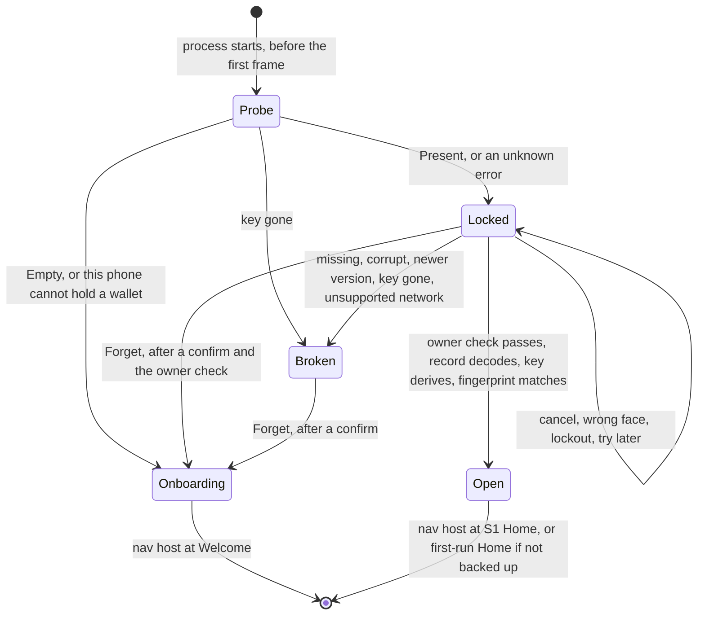

# Wallet storage on this phone (D1)

This page explains how the mebit app keeps a software wallet on this phone only, what it defends against, and what is still unproven. It condenses the D1 design notes (`design.md`, `outcomes.md`, `tests.md` and `sketch.kt` in `.audit/d1-secure-storage/synthesis/`, which are not committed). The code lives under `vault-workspace/mobile-signer-ffi/app/shared/`. Paths below start there.

D1 is testnet only. `SavedWallet` refuses to save or open a `MAIN` record until a security review lifts that limit.

## The problem

Before D1 the app held the 24 words, the BIP-39 passphrase and three routing flags in Compose `remember` state. Every cold start landed on Welcome, so a user who closed the app had to import the words again. D1 keeps that state on this phone only, so a restart opens an unlock screen instead.

Five parts of the app had to meet for that to work, and none of them touched each other before:

- a write point inside `OnboardingSession`, which has five mutators and stages a passphrase import until its fingerprint is confirmed
- a start decision made before any session exists, because the nav host's back stack was seeded from the constant `MovieRoute.start`
- a way to start locked, while `AppLockState` and its test pin an in-session lock that starts unlocked
- a load path that sets the three flags from the record, not from how the key was made
- an Android owner check, which does not exist yet

One more fact decided the layering. `SingleSigHome` binds even with an empty session and then shows the 1,250,000 sat demo fixture. So nothing that reads the session may exist before the wallet is open.

## How a cold start is decided

`WalletGate` (`src/navigation/WalletGate.kt`) runs before the nav host exists. It shows Welcome, the unlock screen, the recovery screen, or the nav host at a Home route. The nav host and every screen in it are composed only after the wallet is open or there is none.

`coldStart(probe)` and `startRoute(backupConfirmed)` in `src/navigation/ColdStart.kt` are pure and total. An unknown error goes to Locked, never to Welcome, because it may hide a saved wallet. `AppLockState` did not change. It still means the in-session lock after 60 seconds away, and it starts unlocked because the nav host that owns it does not exist until the wallet is open.

The layers, from the platform up:

| Layer | File | What it owns |
|---|---|---|
| `SecureStore` | `src/SecureStore.kt` | The only platform seam. Six methods on bytes: `probe` and `marker` never prompt, `read` may show the OS sheet, `write` never prompts and is all or nothing, `erase` is idempotent, `writeMarker` reports whether it took effect. Results are closed enums with no free text. |
| Keychain store | `src@ios/SecureStore.ios.kt` | The iOS actual. It keeps one Keychain item per generation and a marker file. |
| `NotWired` | `src@android/SecureStore.android.kt` | The Android actual until step 6. It stores nothing. |
| `SavedWallet` | `src/data/SavedWallet.kt` | The record codec and its version, the testnet guard, the mapping of platform results to `UnlockResult` and `SaveResult`, and the reinstall rule (`start()` with the pure `reinstallPolicy`). The only code that calls `SecureStore`. |
| `OnboardingSession` | `src/data/OnboardingSession.kt` | One write point (`persist()`), `install`, `proveSavedCopy`, `forgetSavedWallet`, `flushPendingSave`, and the `saved` and `notSavedBecause` state that screens read. |
| `WalletGateState` | `src/navigation/WalletGateState.kt` | The boot state, `unlock`, and an owner-checked `forget`. |
| `WalletGate`, `UnlockScreen` | `src/navigation/WalletGate.kt`, `src/feature/onboarding/UnlockScreen.kt` | The composables. `UnlockScreen` never holds a record and shows no word or fingerprint. |

## What the phone stores

`WalletRecord` (`src/data/WalletRecord.kt`) is the only stored type. It is a plain class with a redacted `toString`, so no generated method can print the words.

| Field | Why it is stored |
|---|---|
| `words`, `passphrase` | Every hot-wallet call needs both, byte for byte. Each is length-prefixed in the codec. |
| `backupConfirmed`, `imported`, `appLockEnabled` | The flags that choose the start route and the in-session lock. |
| `network` | Saved and loaded as `TEST` only. |
| `fingerprint` | A check value. `install` derives the key again and refuses a record whose fingerprint differs, so a damaged passphrase byte cannot open a different, empty wallet. |

The codec header holds the magic `MB` and a version byte. A newer version, an unknown flag bit or an unknown network byte decodes as `Newer` and is never overwritten. The phone stores nothing that the chain or the session can rebuild: balance, address, history, wallet mode, `lastTxid`, `unconfirmedSend`, the keyring, drafts and quiz state.

## iOS keeps one Keychain item and a marker file

- The item is a generic password under service `com.mebit.app.wallet`, account `wallet.<generation>`, with `kSecAttrSynchronizable` false and `SecAccessControl(kSecAttrAccessibleWhenPasscodeSetThisDeviceOnly, .userPresence)`. It never syncs, never enters a backup, stays on this phone, needs a passcode to exist, and the OS deletes it when the passcode is removed. It uses the default access group and no entitlements file.
- `write` adds generation n+1 and then deletes the lower generations. It never calls `SecItemUpdate`, which may prompt for an item with this access control. A crash between the two calls leaves both items, and `probe` and `read` take the newest.
- `probe` lists attributes only, with an `LAContext` whose `interactionNotAllowed` is true, so the cold start never prompts before the unlock screen.
- `read` waits up to 3 seconds for the app to be active, evaluates `deviceOwnerAuthentication` (Face ID first, the passcode inside the same card), and hands that context to the Keychain query (`EVALUATE_BEFORE_READ`). A simulator enforces no Keychain access control, so without this step it would show no card at all. The store's lock is held only around the Keychain calls, never while the card is up.
- The marker file `Application Support/mebit/wallet-marker` holds `empty` or `kept`. It stays in backups on purpose, so a same-device restore keeps a good wallet. `reinstallPolicy(marker, probe)` decides the rest. A fresh install that finds an item left by a deleted install erases it and shows a one-time notice on Welcome. A probe in doubt never wipes.

## Android keeps nothing yet, and a Keystore envelope comes next

Today `NotWired` answers `Unavailable(NotWired)` to every probe, read and write. The app keeps the wallet in memory only, as before D1, and the not-saved notice says so on Key Created and both Home screens. A cold start opens Welcome.

Step 6 plans the real store behind the same seam:

- a non-exportable RSA-2048 key pair in AndroidKeyStore that needs user authentication on every use (`BIOMETRIC_STRONG` or `DEVICE_CREDENTIAL`), StrongBox first
- a random AES-256-GCM key per write, wrapped with the public half, so a write never prompts
- a read that unwraps through the framework `BiometricPrompt` with a `CryptoObject`, which is the one prompt per cold start
- the ciphertext in `noBackupFilesDir`, written through `AtomicFile`
- a probe that checks the wallet file first, so a phone whose screen lock was removed reaches the recovery screen and not Welcome
- API 30 as the floor, with older phones kept memory only, plus `USE_BIOMETRIC`, `configChanges` and `launchMode=singleTask` on `MainActivity`

## Threat model

| Adversary or event | Defended | How |
|---|---|---|
| Cloud and backup copies (iCloud Keychain, iCloud and computer backups, device transfer) | Yes | The item is `ThisDeviceOnly` and not synchronizable. A restore on another phone brings no wallet, and the user types the 24 words. |
| A lost or stolen locked phone | Yes | The item is unreadable while the phone is locked. |
| A thief with an unlocked phone opens mebit | Yes, at cold start | The read needs Face ID or the passcode. A thief who knows the passcode passes. |
| Someone with the unlocked phone taps Forget | Yes | While the copy still opens, Forget needs the OS owner check after the confirm. From the recovery screen the confirm alone erases, because nothing readable is left. |
| An item left by a deleted install | Yes | The first launch of a fresh install erases it, by the user's decision. |
| Another app on the phone | Yes | The sandbox and the default Keychain access group. |
| Code in the app's process before unlock | Yes, for the stored copy | The owner check runs inside the Keychain call, not in app code. |
| The words in memory after unlock | No | Kotlin strings cannot be wiped, FFI copies are not zeroed, and the 60-second lock is a UI gate. |
| Root, jailbreak, OS compromise, memory forensics | No | Out of scope. |
| Coercion, a watched passcode, phishing of the 24 words | No | Out of scope. |
| The OS deleting the item when the passcode is removed | No | Outside the app's control. The next launch says the wallet is gone. |

## Decisions the user made

1. Save every wallet when it is made, and always ask for the owner at launch, even when the user skipped the App Lock step.
2. On iOS a reinstall wipes the old copy, the same as an Android uninstall. Key Created now says that deleting the app removes the wallet from this phone and only the 24 words bring it back. The cost is accepted. An accidental delete before the words were written down loses the wallet for good.

The design proceeds with these defaults until someone decides otherwise. Forget needs the owner check while the copy still opens. The phone's passcode counts as the owner check. A phone with no passcode keeps the wallet in memory only and shows a notice. A cold unlock opens S1 Home when the backup is confirmed and the first-run Home when it is not.

## Outcomes by group

`outcomes.md` lists 66 cases. Two rules hold in every row. Only `forgetSavedWallet()`, after a confirm, deletes the saved copy. A failed write keeps the key in memory and says it is not saved.

| Group | Rows | What the user sees |
|---|---|---|
| Start and read | 1 to 11 | Welcome when nothing is saved or the phone cannot hold a wallet. Otherwise the unlock screen. A cancel, a wrong face, a lockout or a busy phone keeps it locked and installs nothing. |
| Key loss and platform changes | 12 to 19 | A removed passcode, a backup restored on a new phone, or an iOS reinstall opens Welcome with a one-time notice. A record left without its key (Android) opens the recovery screen. |
| Damaged, newer and unsupported records | 20 to 26 | The recovery screen, which offers Forget and an import of the 24 words. A newer record is never overwritten. A missing native library crashes on purpose instead of offering to delete a good wallet. |
| Writes | 27 to 36 | A failed first save shows the not-saved notice and is tried again at the next write point and when the app returns. A failed later save keeps the earlier copy. Create never overwrites a saved wallet. |
| Process and screen lifecycle | 37 to 42 | A killed app asks again at the next launch. Forget asks for a confirm, then the owner. A failed erase keeps the wallet and the screen. |
| Added by the synthesis and the reviews | 43 to 66 | The owner-checked Forget, the Enable read-back, the reinstall rule's edge cases, and the foreground flush. |

Only these rows destroy data. Row 17 erases the orphan of a deleted install, by the user's decision. Row 18 is the user's own Android uninstall. Rows 41 and 44 are a confirmed Forget. Row 54 erases a good wallet if the marker is lost without a reinstall. Row 33 can replace one wallet with another when two app instances run at once, on Android only. The 24 words recover every one of them.

## What has been proven

- Step 1, the pure core, has 38 tests for the codec, the store results, the cold start and the reinstall rule, and 13 mutations of it were caught.
- Step 2, the session, has 19 tests for the write point, staging, refusal to replace and the Enable read-back.
- An adversarial review by three models of steps 1 and 2 found three root causes, all fixed in `046f706`. A model checker replayed 992,784 event sequences, and a fuzz of 300,000 decode inputs never threw.
- Step 3, the Keychain store (`62eb596`), has 28 tests of its pure decisions. A harness ran 81 checks on an iOS 26.5 simulator, including a real `simctl uninstall` and reinstall that wiped the orphan once.
- In step 3b (`12d634c`) the owner check before the Keychain read shows the Face ID card on a simulator, and a store probe returned in 10 ms while the card was up.
- Step 4a: `WalletGateState` has 13 tests, including 1,000 seeded random walks, with 15 mutations caught.
- Step 4b, part 1 (`dedd874`, `32a3cd1`), wired the gate, the unlock and recovery screens, Forget and the Welcome notice, and drove them on a simulator and an Android emulator.
- Step 4b, part 2, added the not-saved notice, the delete warning on Key Created and the Enable read-back. The three pure functions (`notSavedText`, `readBackScan` and `goesOnWithoutLock`) have 12 tests, and 17 one-rule mutations of them were all caught. On an iPhone 17 Pro simulator (iOS 26.5), 118 driven steps passed with none failing: the read-back card at Enable, a miss and a cancel, a cold start that reopened the same key, the reinstall wipe, Forget, and the notice for a store that refused writes or read back a different copy. That run found that after a failed read-back the primary button showed the line for a phone without Face ID, and its link then turned the lock on. `goesOnWithoutLock` (`src/feature/onboarding/ReadBackScan.kt`, `4e31121`) now goes straight on without a lock. A second simulator run with the same probe showed first-run Home with the notice, and the lock still off after 80 seconds away. The simulator's keychain database showed one item of class `akpu`, not synchronized. On the Android emulator, 20 steps passed: the notice on Key Created and Home, and Welcome after a relaunch. `vault-workspace/mobile-signer-ffi/app/.claude/skills/verify/features/wallet-restart.md` holds the commands.

The Kotlin/Native test executable gets `errSecMissingEntitlement` for every Keychain call, so no unit test touches the real Keychain. Those proofs are the simulator runs.

## What each platform still owes

The iPhone run owes the parts a simulator cannot show:

- whether one read shows one sheet or two (`EVALUATE_BEFORE_READ` switches to the Keychain's own sheet if it is two)
- the signed device build
- real Face ID, a failed face and the passcode inside one card
- a kill while the card is up
- removing the passcode, which must make the next launch say the wallet is gone
- a delete and reinstall, which must open Welcome with the notice
- that a cold start never stays inactive longer than the 3-second wait

Android owes step 6 (the Keystore store) and step 7 (`Biometrics`, so the App Lock screen, the 60-second lock and the sign check work there). Both wait for decisions on the API floor, `minSdk`, `allowBackup` and `launchMode`. The emulator proof needs a PIN set with `adb shell locksettings set-pin`, and the hardware proof needs the POCO X3 NFC and the Galaxy S25 FE.

## Known gaps

- Two live app instances can bring back a forgotten wallet over a new one through a stale `Replace` (outcomes row 33). It needs two instances in one process, which happens on Android only. `launchMode=singleTask` and a compare-and-swap `Replace` are the planned fixes. The second touches the store seam and should land before any real money.
- A Forget from the unlock screen whose erase fails reads as "cannot open now", not as a failed erase.
- The Welcome notice shows again if the user returns to Welcome in the same launch.
- A user whose probe was in doubt may scan Face ID and then see the recovery screen for a missing item, because the face check now comes before the store looks for an item.
- If the last flag write fails and nothing writes again before the app is killed, the stored `appLockEnabled` can be stale after a restart.
- A payment of unknown outcome is forgotten by a restart, because `unconfirmedSend` is not stored yet.
- The keyring, vaults, paired devices and the Trezor pairing credential do not survive a restart.
- No Penpot board exists for the unlock screen, the recovery screen, the Forget sheet, the Welcome notice, the not-saved notice or the delete warning. `docs/04-open-items.md` lists them with their Thai copy.

## Next steps

1. Run the iPhone acceptance with a person: create, back up, enable the lock, kill, relaunch and unlock, then the reinstall wipe.
2. Add the compare-and-swap `Replace` before any real money.
3. Persist `unconfirmedSend` (step 9), so a restart cannot reopen a double payment.
4. Build the Android Keystore store (step 6) and Android `Biometrics` (step 7) once the API floor and the manifest questions are decided.
5. Optionally hide the screen under the in-session lock from accessibility (step 8).
6. Have the security review read D1, including the Android envelope, before the testnet-only limit is lifted.
